# How Rustroom works

A map for a photographer who programs — or who has an AI assistant do the programming. It explains
what happens to a photo between opening it and exporting it, where each part of that lives in the
code, and which steps a typical change takes. The rules a change must follow are in
[`AGENTS.md`](AGENTS.md); how to build and test is in [`CONTRIBUTING.md`](CONTRIBUTING.md).

## 1. The big idea: your original is never touched

Like Lightroom Classic, Rustroom never changes a photo file. An edit is a **list of settings** — white
balance, exposure, a mask with its own sliders, a crop — and the picture you see is that list
**replayed** on the original every time. That one decision is why history, snapshots, virtual
copies, presets and "copy settings" are cheap: they are all just lists of settings.

The list is the `Edits` type in the `edit-model` crate, and it is saved in two places:

| What | Where | Why there |
|---|---|---|
| The edit itself | a JSON **sidecar** beside the photo (`photo.RAF.json`) | travels with the file when you copy or move a folder |
| Stars, colour labels, keywords, title and caption | the **catalog**, and written to the photo's `.xmp` sidecar | other apps (Lightroom, darktable, digiKam) read the `.xmp` |
| History, collections, smart collections, stacks, publish services, map locations, people's names | the **catalog** only (SQLite, in Rustroom's settings folder) | they describe your library, not one file — and locations and names stay private on purpose |

## 2. The picture's journey

Opening a photo **decodes** it once into a linear, floating-point image. Everything after that is a
chain of **stages**, each a small, separately tested step that takes an image and returns one. The
chain has two halves:

```mermaid
flowchart LR
    D[Decode<br/>RAW · JPEG · HEIC] --> P
    subgraph P [Prefix — fixes the capture]
        direction LR
        P1[AI denoise] --> P2[Removals] --> P3[Lens] --> P4[Negative] --> P5[Noise reduction] --> P6[Dehaze] --> P7[Spots · red eye] --> P8[Geometry<br/>one resample] --> P9[Defringe · masked NR/dehaze · lens blur]
    end
    P --> T
    subgraph T [Tail — makes the picture]
        direction LR
        T1[White balance] --> T2[Exposure] --> T3[Tone · curve] --> T4[Clarity · texture] --> T5[Colour · HSL · grading] --> T6[Masks] --> T7[Effects] --> T8[Sharpen] --> T9[Camera look]
    end
    T --> O[Output: display or export]
```

- **The prefix** repairs what the camera and lens did: noise, distortion, haze, dust, a crooked
  horizon. **Geometry comes last in it** — rotation, keystone, straighten and crop all happen in **one**
  resample, so the picture is resampled once, not four times.
- **The tail** is where the look is made, and it works on the final, cropped pixels. That is why the
  vignette follows the crop for free.
- **Noise reduction early, sharpening late.** Denoising the raw capture is far easier than denoising
  grain that exposure and curves have already amplified; sharpening goes last so nothing stretches it.

**Why a slider drag is fast.** The prefix's result is cached after each step. Dragging Exposure
re-runs only the tail; dragging Straighten re-runs only the one resample and the tail. While you edit,
Rustroom renders only the part of the photo you can see, at your screen's resolution; the full-size
render happens for export and 1:1. The code for this is `pipeline::prefix` (the steps and their cache
keys) and `crates/app/src/render_engine/`.

**Where marks are kept.** Spots, red-eye circles and brush strokes are stored in the photo's own
coordinates (decode space), so they stay on their content when you change lens correction or
perspective later. `pipeline::anchors::resolve` maps them at the start of every render.

## 3. Linear light, briefly

Cameras record light linearly: twice the light, twice the number. Rustroom keeps it that way — every
calculation happens in **linear light** in a wide colour space (linear ProPhoto), in 32-bit floating
point, so nothing clips or bands between stages. Only at the very end is the picture converted for
your screen, or for the file you export (sRGB, Display P3, Adobe RGB, ProPhoto). Camera colour comes
from DCP profiles, or from a look **learned from your own camera's JPEGs** (Fujifilm film
simulations today).

## 4. The GPU

Every stage has a CPU version, which is the **reference**: it defines the correct picture. Most stages
also have a GPU **twin** (`crates/gpu-pipeline`) written as `wgpu` compute shaders, and the tail runs on
the GPU when one is available. Tests render the same photo both ways and require the results to match
— a GPU twin is a speed-up, never a different picture.

## 5. AI features run on your computer

Subject and object masks, depth, removing things and people, denoising and face recognition use
open neural-network models (ONNX, run with `tract`). Each is listed with its source and licence in
`crates/ai-mask/src/registry.rs`, downloaded once when first needed, and run **locally** — no photo
leaves your machine. Their results (a mask, a filled area, a denoised image) are cached on disk and
stored in the photo's own coordinates, like the marks above.

## 6. The crates

The project is a Cargo workspace of small crates. Only the app uses the GUI library; everything else
can be driven from the command line and from tests.

| Group | Crate | What it does |
|---|---|---|
| Decoding | `raw-decode` | RAW files through libraw; floating-point DNGs (HDR and panorama results) by its own reader |
| | `image-decode` | JPEG, PNG, TIFF, and HEIC/HEIF through libheif |
| | `core-image` | the image type every stage passes along, and capture facts (EXIF) |
| Colour and lenses | `color` | transfer functions and Oklab |
| | `camera-profile` | Adobe DCP camera profiles |
| | `lens-profile` | lens corrections from lensfun's database |
| Editing | `edit-model` | `Edits`, the list of settings, and its groups for copy/paste and presets |
| | `pipeline` | the stages, the prefix and tail, masks, the golden-image tests |
| | `gpu-pipeline` | the GPU twins and the code that swaps them in |
| | `ai-mask` | the AI models: where they come from and how they run |
| | `photo-merge` | HDR and panorama merges |
| | `lr-preset` | reading Lightroom presets into Rustroom edits |
| Output | `export` | writing JPEG, PNG, TIFF and DNG, with metadata, watermarks and output sharpening |
| | `xmp` | reading and writing `.xmp` sidecars |
| Library | `catalog` | finding photos in folders, and the SQLite catalog |
| | `immich` | the client for a self-hosted Immich server |
| | `tether` | tethered capture through libgphoto2 |
| The programs | `app` | the `Rustroom` desktop app — its **library** half holds the logic and has no GUI code; its **binary** half draws the window with egui |
| | `rustroom` | `rustroom-cli`, which decodes and renders from the command line |
| Tests | `test-dir` | a private temporary folder for every test, and repository-wide checks |

The split inside `app` matters: anything that can be tested without opening a window belongs in its
library half. `AGENTS.md` has the full placement table.

## 7. Recipes

Each recipe ends with the tests that stay red until every step is done — they are how you know you
have not missed one.

### A new slider

1. **The setting:** a field on `Edits` (or on a sub-struct) in `edit-model`, with
   `#[serde(default, skip_serializing_if = "…::is_default")]` so old sidecars and cached previews stay
   valid. Add it **at the end** of the struct.
2. **Its group** in `EditGroups` (what copy/paste, presets and sync carry), and the destructure in
   `Edits::merge_from`.
3. **The fixtures that set every field:** `edit_model`'s `all_nonneutral()`,
   `pipeline::test_fixtures::all_edits()` and the `rich` literal in `edit_clipboard`'s
   `the_payload_survives_every_group` test. They build `Edits` without `..`, so the compiler points
   at each one. ⚠ For a tail stage, also set the field in `gpu-pipeline`'s `every_tail_stage()` —
   it ends in `..Edits::default()`, so the compiler cannot point at it, and a stage missing from it
   silently splits the GPU tail.
4. **The stage** that uses it, in `crates/pipeline/src/stages/`.
5. **Its GPU twin** with a `REPLACEABLE` row in `gpu-pipeline` (every tail stage needs one).
6. **The slider** in the Develop panel (`crates/app/src/develop/panel/`), with its default for
   double-click reset, and its hover text (one short sentence, no full stop).

Tests that catch a missed step: `every_group_transfers_something`,
`every_tail_stage_is_replaceable_or_a_mask`, `every_slider_resets_to_its_fields_default`,
`every_hover_is_one_short_sentence`, `the_fingerprint_is_stable_across_calls_and_pinned`.

### A new pipeline stage

One file in `crates/pipeline/src/stages/`, implementing `PipelineStage`, with its parameters set when
it is built. A **tail** stage also needs its GPU twin and `REPLACEABLE` row (above). A **prefix** step
gets its own `PrefixStepKey` carrying its whole setting, so changing it invalidates exactly the cached
steps after it — `every_prefix_step_has_its_own_key` checks that, and the three prefix tests that
count steps must be renumbered on purpose. If the change alters a rendered picture, add a golden
test (`crates/pipeline/tests/golden.rs`, appended at the end).

### A new kind of mask

A mask's coverage is computed in three places — `Composite::at` (CPU), `mask_wgsl::coverage_entry`
(GPU) and the Show-mask tint — and its shape is part of three cache keys: `capture_projection`,
`defringe_projection` and `TintCache::same_shape`. A new kind must reach all six. New `Mask` variants
are appended at the end, so every existing sidecar still reads.

### A new file format

The extension goes into `catalog`'s `RAW_EXTENSIONS` or `IMAGE_EXTENSIONS`; decoding into
`raw-decode` or `image-decode` (returning the same linear image every other format does, with its
orientation applied); the thumbnail path, the import survey's quick EXIF read
(`image_decode::quick_look`), the Open dialog's list of extensions (`session_flow`'s `open_dialog`)
and the Library's format filter (`crates/app/src/format_filter.rs`) need it too. Add a small sample to the tests only if its licence allows
redistribution — otherwise a test reads it from a path you set locally, the way the RAW tests do.
