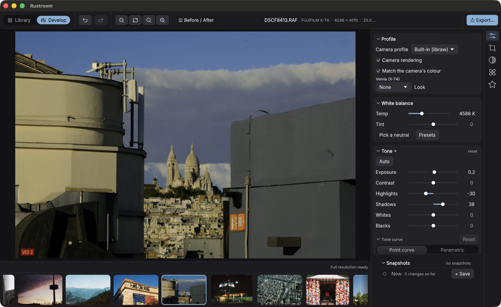
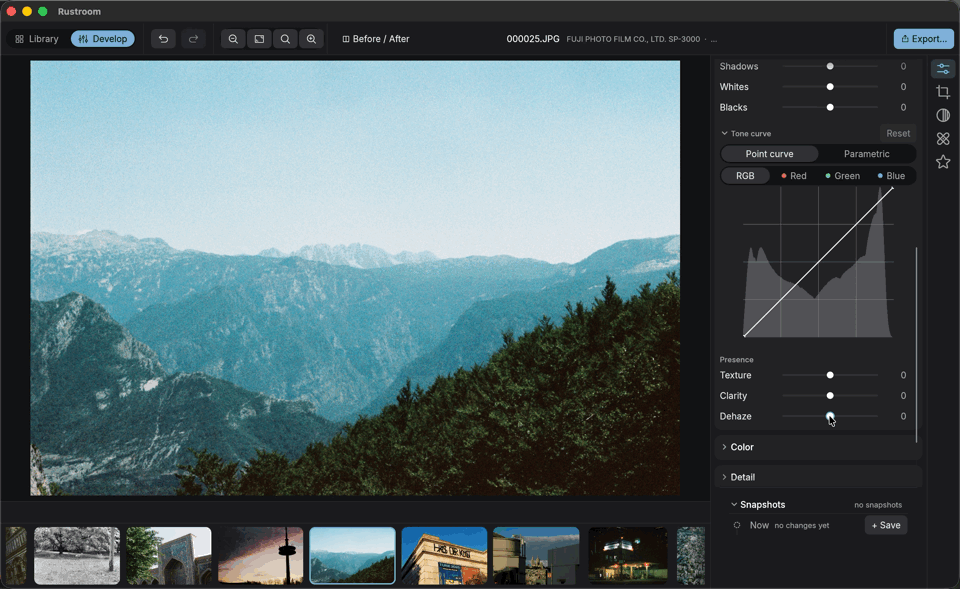
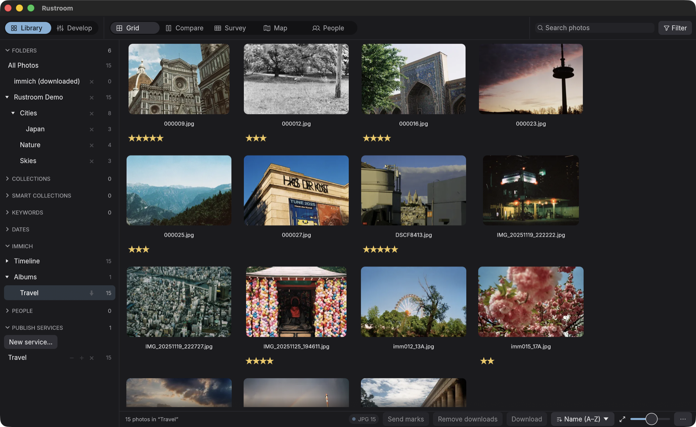
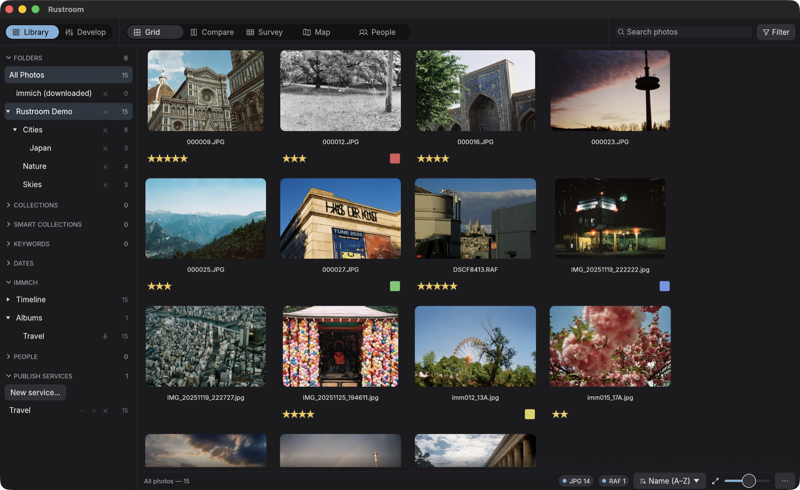
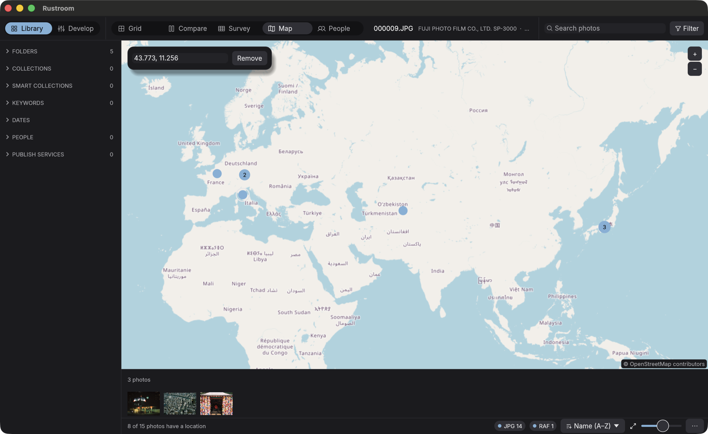
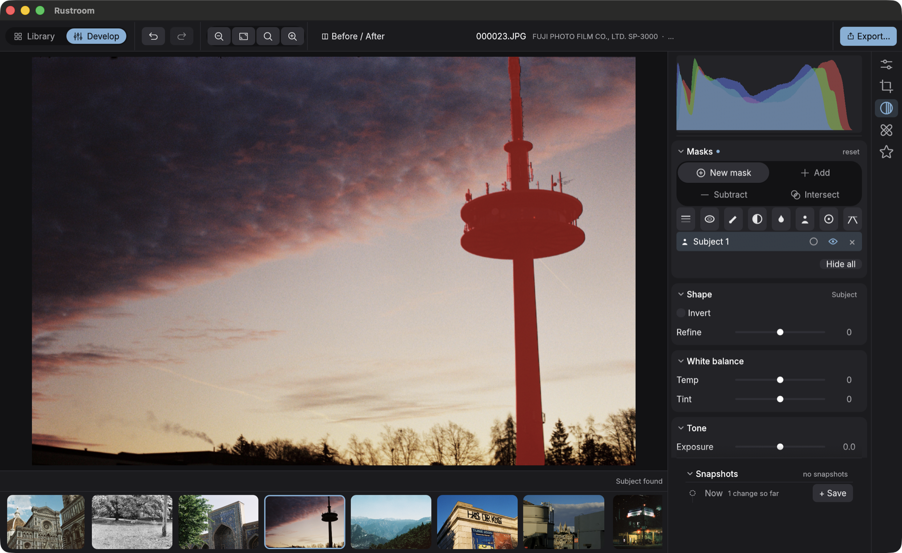

# Rustroom

**A RAW photo editor on Lightroom Classic's model — open source, no subscription, no account.**

Rustroom is a complete darkroom for your RAW files: a **Library** to import, sort, rate and find your
photos, and **Develop** to edit them — with masks, AI selections, retouching, HDR and panorama
merges, tethered shooting, a map, print and export. It runs on **macOS, Windows and Linux**.

- **Professional grade.** Edits happen in scene-referred linear light in a wide colour space, in
  32-bit floating point, so nothing clips or bands between steps. Camera colour comes from the
  DCP profiles you install — read exactly as Adobe's own DNG SDK reads them — or, for Fujifilm
  cameras, from a look **learned from your own camera's JPEGs**. The editing pipeline runs on your graphics card.
- **Feature-rich.** Everything you reach for in Lightroom Classic's Library and Develop modules,
  listed [below](#what-it-does).
- **Open source.** GPL-3.0-or-later. No subscription, no account, nothing to activate.
- **Tested.** Over 4,700 automated tests, including 94
  golden-image tests that pin exactly what the editing pipeline renders, run on every change. Every
  stage that runs on the graphics card is checked against its reference on the processor.

## Your photos stay yours

*Your files are never changed, edits are kept separately beside them.* Rustroom keeps every edit as
a small sidecar file next to the photo, so your originals are untouched and your edits travel with
your folders.

- **No account, no cloud, no telemetry.** Rustroom does not phone home.
- **Every AI feature runs on your computer** — subject masks, removing objects and people, denoising,
  recognising faces. Each model is downloaded once, when you first use its feature — from GitHub or
  Hugging Face, either its authors' own release or a public conversion of it — and its licence is
  shown before it is fetched. The AI never sends a photo anywhere.
- **Rustroom goes online only for what you ask of it:** the AI models above, the Map's tiles from
  OpenStreetMap, a place name you look up (through OpenStreetMap's Nominatim), and your Immich
  server if you connect one. A photo leaves your computer only when you upload or publish it to
  your own Immich server.
- **Locations and people's names live in Rustroom's catalog**, never in your originals or their
  sidecars, and people's names never leave Rustroom. A location does travel with an **export** — and
  so with an upload or a published album — unless you set the export's metadata to *Copyright only*.
  (Showing the Map fetches the tiles for the area you look at, from OpenStreetMap or a tile server
  you choose in Settings.)

## Immich

Rustroom works with a self-hosted [Immich](https://immich.app) server as a second library, beside
your folders.

- **Browse your server** in the Library — its timeline by year and month, and its albums.
- **Edit any server photo** in Develop. It is downloaded when you open it and kept, until you clear
  the downloads yourself in Settings.
- **Upload your exports** back to the server, with the date you choose.
- **Send stars and favourites** to Immich when you confirm — with *Undo last send*. Stars and
  favourites set in Immich fill in Rustroom's once, and never overwrite your own.
- **Publish to an album:** a publish service keeps an Immich album in step with a set of photos.
- **People from Immich** appear beside the faces Rustroom finds itself.
- **Your keys stay in the system keychain**, where the system has one (otherwise in Rustroom's own
  settings file). A read key and a separate write key let you decide whether Rustroom may change
  anything at all.

And plainly what it never does: **Rustroom never deletes a photo from your server.** It writes to
Immich only when you send marks, upload an export or publish an album.

## What it does

**Library**

- Import from a memory card into date folders, or work on folders in place; a folder tree that
  follows photos you move.
- Stars, flags, colour labels, keywords and descriptions; stars, labels and keywords are written to
  an `.xmp` sidecar beside each RAW file, for other apps. Batch rename.
- Collections, smart collections, stacks (RAW + JPEG pairs automatically, your own by hand), virtual
  copies, and Compare and Survey views.
- **Map**: photos placed by their GPS, or by dropping them where they were taken.
- **People**: faces found and grouped on your computer; you name them.
- **Publish services** to a folder or an Immich album.
- Fast at scale — tested with a catalog of 100,000 photos.

**Develop**

- White balance, exposure, contrast, highlights, shadows, whites and blacks; a point and parametric
  tone curve with red, green and blue channels; HSL; colour grading; clarity, texture and dehaze.
- Noise reduction, and **AI denoise**; sharpening; lens corrections (distortion, vignetting,
  chromatic aberration) from the lensfun database; defringe.
- Crop, straighten and perspective correction; vignette and grain.
- Camera profiles (DCP) and creative looks (3D LUTs) from your own files; film negative conversion.
- History that survives a restart, snapshots, presets, copy and paste of settings, soft proofing.

**Masks**

- Brush (with auto mask), linear and radial gradients, colour and luminance range, **depth range**.
- **AI**: select the subject, or click on anything to select it.
- Combine them (add, subtract, intersect, invert); each mask has its own white balance, exposure,
  tone, colour, sharpening, noise reduction and dehaze.

**Retouch**

- Heal and clone; red eye and pet eye in one click.
- **Remove** anything you paint over, filled in by AI; **find people** in the background and remove
  them; **find sensor dust** and heal every spot at once.

**Lens Blur** — blur the background after the fact, from a depth map, with the bokeh shape of your
choice.

**Photo merge** — **HDR** from a bracket (with automatic alignment and ghost removal) and
**panoramas** (spherical, cylindrical or perspective, with automatic crop and filled edges), each
saved as a new raw file you can keep editing.

**Tethered shooting** — shoot with your camera on a USB cable; each frame lands in the Library and
opens in Develop.

**Export and print** — JPEG, PNG, TIFF and DNG; 8 or 16 bits; sRGB, Display P3, Adobe RGB or
ProPhoto; size in pixels, centimetres or inches, a file-size limit, renaming templates, text and
image watermarks, output sharpening, and control over which metadata leaves with the file. Print
single photos or contact sheets to a PDF.

## Coming from Lightroom

- **The model is the one you know:** Library and Develop, virtual copies, snapshots, history,
  collections and smart collections, stacks, publish services.
- **Your Lightroom presets come with you:** `.xmp` presets, the older `.lrtemplate`, and `.zip`
  packs. Anything a preset sets that Rustroom does not have is named to you, never silently dropped.
- **Stars, labels and keywords** that Lightroom wrote into `.xmp` sidecars beside your RAW files are
  read when you open the folder.
- **What does not come across:** Rustroom does not read Lightroom catalogs (`.lrcat`), so edits made
  in Lightroom stay there — and a preset is an approximation, because the processing is Rustroom's own.

## Download

Get Rustroom for your system from the
**[latest release](https://github.com/wladiKrin/rustroom/releases/latest)**.

| System | Download | Requires |
|---|---|---|
| macOS | <!-- fill at v0.1: file and signing --> | <!-- fill at v0.1: minimum macOS version --> |
| Windows | <!-- fill at v0.1: installer --> | <!-- fill at v0.1: minimum Windows version --> |
| Linux | <!-- fill at v0.1: package format --> | <!-- fill at v0.1: distributions, bundled libraries --> |

<!-- fill at v0.1: the graphics card requirement -->

**Cameras.** Raw files from Canon (CR2, CR3), Nikon (NEF), Sony (ARW), Fujifilm (RAF), OM System and
Olympus (ORF) and Panasonic (RW2), and any DNG — decoded by [LibRaw](https://www.libraw.org), which
knows over 1,200 camera models. JPEG, PNG, TIFF and HEIC/HEIF photos open too.

To build Rustroom yourself, see [`CONTRIBUTING.md`](CONTRIBUTING.md).

## Where next

- **A question, or an idea?** Ask in [Discussions](https://github.com/wladiKrin/rustroom/discussions).
- **Something broken?** [Report a bug](https://github.com/wladiKrin/rustroom/issues/new/choose).
- **Want to change something?** Read [`CONTRIBUTING.md`](CONTRIBUTING.md) — no Rust expertise
  needed to start, and [`ARCHITECTURE.md`](ARCHITECTURE.md) explains how a photo travels through
  Rustroom.

## Credits

Rustroom stands on these open-source projects: [LibRaw](https://www.libraw.org) (LGPL-2.1 / CDDL),
[Little CMS](https://www.littlecms.com) (MIT), [lensfun](https://lensfun.github.io) (LGPL-3.0) and
its lens database (CC-BY-SA 3.0, by the LensFun contributors),
[libheif](https://github.com/strukturag/libheif) and libde265 (LGPL-3.0),
[libgphoto2](http://www.gphoto.org) (LGPL-2.1), [egui](https://github.com/emilk/egui) and
[wgpu](https://wgpu.rs) (MIT / Apache-2.0), [tract](https://github.com/sonos/tract) (MIT / Apache-2.0)
— and map data
© [OpenStreetMap](https://www.openstreetmap.org/copyright) contributors.

**The AI models**, each downloaded when you first use its feature — every file's source and licence
are listed in [`crates/ai-mask/src/registry.rs`](crates/ai-mask/src/registry.rs):

| Feature | Model | Licence |
|---|---|---|
| Select subject (default) | [IS-Net](https://github.com/xuebinqin/DIS) | Apache-2.0 (code); the weights carry no explicit licence |
| Select subject (alternative) | [BiRefNet](https://github.com/ZhengPeng7/BiRefNet) (lite) | MIT |
| Select by click, detect objects | [MobileSAM](https://github.com/ChaoningZhang/MobileSAM) and the [Segment Anything](https://github.com/facebookresearch/segment-anything) decoder | Apache-2.0 |
| Depth range masks, lens blur | [Depth Anything V2](https://github.com/DepthAnything/Depth-Anything-V2) Small | Apache-2.0 |
| Remove | [LaMa](https://github.com/advimman/lama) | Apache-2.0 |
| Find people | [YOLOX](https://github.com/Megvii-BaseDetection/YOLOX)-m | Apache-2.0 |
| Faces: finding · telling apart | [YuNet](https://github.com/opencv/opencv_zoo/tree/main/models/face_detection_yunet) · [SFace](https://github.com/opencv/opencv_zoo/tree/main/models/face_recognition_sface) (OpenCV Zoo) | MIT · Apache-2.0 |
| AI denoise (default) | [FFDNet](https://github.com/cszn/KAIR) | MIT — trained partly on ImageNet images, whose terms are research-only |
| AI denoise (alternative) | [DRUNet](https://github.com/cszn/DPIR) | MIT — trained partly on DIV2K, whose terms are research-only |

## Licence

Rustroom's code is **GPL-3.0-or-later** — see [`LICENSE`](LICENSE).

The photographs shown in the screenshots are the author's, all rights reserved: they are not covered
by the GPL, and the photographs themselves are not published.
